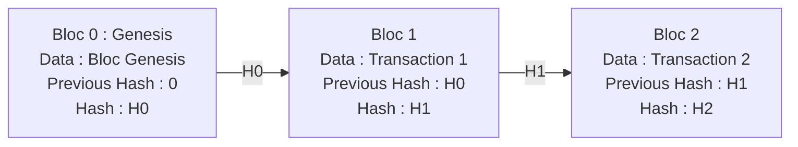

# Documentation : Chaînage des blocs et comparaison

## 1. Schéma commenté du chaînage des blocs

Une blockchain est une chaîne de blocs liés entre eux grâce aux empreintes cryptographiques (hash). Chaque bloc contient notamment le hash du bloc précédent.

### Schéma du fonctionnement

### Explication des éléments

- **Index :** numéro qui identifie chaque bloc dans la chaîne.
- **Timestamp :** date et heure de création du bloc.
- **Data :** informations stockées dans le bloc.
- **Previous Hash :** empreinte cryptographique du bloc précédent.
- **Hash :** empreinte unique calculée à partir des informations du bloc avec l'algorithme SHA-256.

### Fonctionnement du chaînage

1. Le premier bloc est appelé Genesis Block. Il représente le point de départ de la blockchain.
2. Lorsqu'un nouveau bloc est créé, il récupère le hash du bloc précédent.
3. Le nouvel identifiant cryptographique est calculé à partir de ses propres informations et du Previous Hash.
4. Ainsi, les blocs sont liés entre eux et forment une chaîne.

### Rôle du hachage cryptographique

Dans notre mini-blockchain, l'algorithme SHA-256 permet de générer une empreinte à partir des données du bloc.

Si une donnée d'un ancien bloc est modifiée, son hash change également. Le hash enregistré dans le bloc suivant ne correspond alors plus au hash du bloc précédent, ce qui permet de détecter une modification lors de la vérification de la chaîne.

## 2. Comparaison : Blockchain publique, Blockchain permissionnée et base de données classique

### A. Blockchain publique

Une blockchain publique est un réseau ouvert auquel tout le monde peut participer. Les transactions peuvent être consultées par les utilisateurs et le fonctionnement repose sur un mécanisme de consensus.

**Exemples :** Bitcoin et Ethereum.

### B. Blockchain permissionnée

Une blockchain permissionnée est un réseau dont l'accès est réservé aux participants autorisés. Les droits de lecture, d'écriture et de validation sont contrôlés.

Elle est souvent utilisée par les entreprises et les organisations qui souhaitent partager des informations de manière sécurisée.

**Exemple :** Hyperledger Fabric.

### C. Base de données classique

Une base de données classique permet de stocker, organiser et gérer des informations. Elle est généralement administrée par une organisation centrale qui contrôle les accès et les modifications.

**Exemples :** MySQL et PostgreSQL.

### Tableau comparatif

| Critères | Blockchain publique | Blockchain permissionnée | Base de données classique |
|---|---|---|---|
| Accès | Ouvert à tous | Réservé aux membres autorisés | Contrôlé par l'administrateur |
| Gestion | Décentralisée | Plusieurs participants autorisés | Centralisée |
| Transparence | Élevée | Limitée aux participants autorisés | Selon les droits d'accès |
| Sécurité | Cryptographie et consensus | Cryptographie et contrôle des accès | Contrôle des accès et mécanismes de sécurité |
| Modification des données | Très difficile | Contrôlée selon les règles du réseau | Possible selon les autorisations |
| Performance | Variable selon le réseau | Généralement élevée | Généralement élevée |
| Utilisation | Cryptomonnaies et applications décentralisées | Échanges entre organisations | Gestion des données d'une organisation |

## 3. Conclusion

La blockchain publique favorise la transparence et la décentralisation, tandis que la blockchain permissionnée offre un meilleur contrôle des participants et des accès.

En revanche, une base de données classique est généralement plus simple à gérer et adaptée aux systèmes centralisés.

Notre mini-blockchain pédagogique permet de comprendre le principe fondamental de la technologie blockchain : le chaînage des blocs par des empreintes cryptographiques SHA-256.
